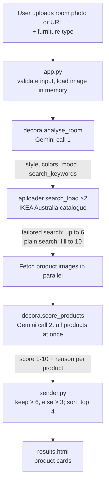

# Decora demo guide

A walkthrough of how Decora works, for demoing it to someone. For each step it covers what the audience sees, what to say, and what happens behind the scenes.

## One-line pitch

"Upload a photo of your room, say what furniture you need, and Decora tells you which IKEA products suit that room, with a score and a reason for each."

## The whole flow

```
Room photo + "sofa"
   → Gemini call 1: style, colours, mood, keywords
   → IKEA search ×2: up to 10 candidates
   → download product images in parallel
   → Gemini call 2: score all candidates against the room
   → keep scores ≥ 6, top 4, show with reasons
```



## Step by step

### 1. Home page: the input

**What they see:** a form with a room photo upload (or an image URL) and a furniture type box ("sofa, dining table, lamp…").

**What to say:** "No filters, no style quiz. Just a photo of your room and what you're shopping for."

**Behind the scenes** (`app.py`, `/process_url`):
- **Checks:** the furniture type must be letters, numbers and spaces (max 50 characters), and the image must be under 8 MB. A pasted URL is additionally checked to resolve to a public address, so the field can't be pointed at the internal network.
- **No saving:** the image stays in memory and is never written to disk, which is what lets the app run on Vercel's serverless functions.
- **Loading screen:** clicking *Find matches* shows "Analysing your room… about 30 seconds". A typical search takes about 18 seconds.

### 2. Analyse: Gemini looks at the room

**Behind the scenes:** `decora.analyse_room()` makes the first Gemini call. It sends the photo, shrunk to 768 px or smaller, and gets back structured JSON:

```
style:           "Scandinavian minimalist"
colors:          ["warm oak", "white", "dusty blue"]
mood:            "bright, airy, relaxed"
search_keywords: "white oak, blue fabric"
```

**What to say:** "Gemini doesn't just label the style. It also picks out concrete colour and material words, because IKEA's search understands 'white oak' but not 'Scandinavian minimalist'."

### 3. Search: pull candidates from IKEA

**Behind the scenes:** `sender.gen_everything()` runs two searches on IKEA's Australian catalogue through `apiloader.search_load()`:

1. **Tailored search:** `"{furniture type} {search_keywords}"`, e.g. "sofa white oak, blue fabric", taking up to 6 products.
2. **Plain search:** `"{furniture type}"`, filling up to 10 products total.

Colour and size variants are included, duplicates are removed by product id, and items with missing or malformed data are skipped.

**What to say:** "The tailored search finds on-style items. The plain search is a safety net, because keyword searches sometimes drift off-category."

### 4. Score: Gemini compares everything at once

**Behind the scenes:**
- **Images:** all candidate product photos (the plain white-background shots) are downloaded in parallel.
- **One call:** `decora.score_products()` makes the second and last Gemini call, sending the room photo plus all candidates together.
- **Scoring:** Gemini gives each product a 1–10 score on colour harmony, style, material and mood, plus a one-sentence reason.
- **Relative scores:** it's told to judge the products against each other, so scores spread out instead of all landing at 7–9.
- **Wrong category:** anything that isn't actually the requested furniture type (say, a TV bench) scores 1.

**What to say:** "This is the key design choice. Scoring products one at a time made every score look the same. Showing Gemini the whole lineup next to the room makes it rank them."

### 5. Results page

**What they see:** up to 4 product cards (`web/results.html`), each with image, name, **"9/10 match"**, the reason, the AU$ price and the IKEA star rating. Each links to the IKEA product page.

**Behind the scenes:**
- **Filtering:** keeps products scoring 6 or higher, best first.
- **Fallback:** if none reach 6, it shows the 3+ ones instead.
- **Never shown:** 1–2 scores, which mean wrong category.

**What to say:** point at a reason, e.g. *"Its warm ochre upholstery complements the oak herringbone floors…"*. It explains the choice in terms of the user's own room.

## Talking points

- **Cheap:** only 2 AI calls per search, whatever the number of products. That's roughly half a cent per search on `gemini-3.8-flash` (an estimate).
- **Metered:** the endpoint is rate limited per IP (10/hour) with a global daily ceiling, so a public demo link can't run up the AI bill. Over-limit requests get a 429 before anything is spent.
- **Resilient:** each Gemini call has a 30 s timeout. On an overload or timeout it retries once, then switches to the faster `gemini-3.5-flash-lite`, so the user still gets results. If both fail, they see "Our AI stylist is busy right now. Please try again in a minute." instead of a crash.
- **Lessons learned:** earlier designs were worse:
  - Scoring each product against a text description of the room lost the visual detail, and every score clustered around 7–9.
  - Comparing IKEA's styled room photos (commit `a6330a5`, reverted) made the model compare two rooms instead of room vs. product.

## Demo tips

- **Room photo:** pick one with a clear, distinctive palette (strong wood tones, a coloured wall). The reasons get much more specific.
- **Furniture type:** use a common one like "sofa" or "armchair". Plenty of IKEA results means a real spread of scores.
- **Warm-up:** do one practice search right before the demo, so the serverless function is already running.
- **Timing:** narrate steps 2–4 during the ~20 s wait. The loading screen is your cue.

## If someone asks about testing

`pytest` runs 301 tests in about five seconds with no network and no API key —
Gemini, IKEA and image fetching are all faked. CI runs them plus `ruff` on Python
3.10 and 3.13 for every push and pull request. The tests worth mentioning are the
ones around the index remapping in `sender.py`: if a score ever attached to the
wrong product, every result would be mislabelled and the page would still look
entirely plausible.

## Where things live

| Step | File | Function |
|------|------|----------|
| Form + validation | `app.py`, `web/index.html` | `process_url` route |
| Pipeline orchestration | `sender.py` | `gen_everything()` |
| Room analysis | `decora.py` | `analyse_room()` |
| IKEA search | `apiloader.py` | `search_load()` |
| Product scoring | `decora.py` | `score_products()` |
| Retry + fallback | `decora.py` | `_generate_with_retries()` |
| Results page | `web/results.html` | n/a |
